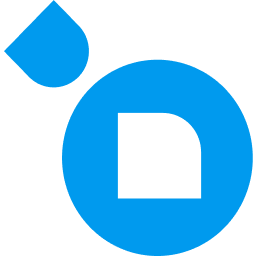

# Video editor jobs: remote in Europe

[All job listings](https://github.com/noah-42/job-listings) · [Video editor directory](README.md) · [Discovery catalogue](discovery.md) · [CSV](data/jobs.csv) · [JSON](data/jobs.json)

Current GitHub window: posting dates 2026-05-12 onward (rolling six calendar months). Older and unknown-date records are excluded from this visible list and current exports. [Full source archive](archive-all-records.json) retains all records; no source database records were changed. Logos: fit within 60x60px, aspect ratio preserved.

46 display rows from 107 recent source records, newest first. Remote roles open in Europe. Country scope and residency notes come from the Jobscout record; unconfirmed eligibility is labeled. 🇬🇧 English sufficient · 🇩🇪 German required · Unclear: not confirmed. Pending means the complete Jobscout-image and Favicon Hub checks are not established.

| Logo&nbsp;&nbsp;&nbsp;&nbsp;&nbsp;&nbsp;&nbsp;&nbsp;&nbsp;&nbsp;&nbsp;&nbsp;&nbsp;&nbsp;&nbsp;&nbsp;&nbsp; | Company | Title | Posted (2026; older years labeled) | Location | Pay range | Language | Requirements |
| :---: | :--- | :--- | :--- | :--- | :--- | :--- | :--- |
|  | [EverAI](http://everai.com/) | [Mid/Senior AI Cinematic Video Editor (Freelance - Full Remote - Netherlands)](https://www.arbeitnow.nl/jobs/companies/everai/mid-senior-ai-cinematic-video-editor-freelance-full-remote-netherlands-47369) | Nov-11 | Netherlands; remote (within Netherlands only) | USD 20 / hour | 🇬🇧 | Skills: adobe cc, due diligence, llm, video, writing; Senior |
|  | [EverAI](http://everai.com/) | [Mid/Senior AI Cinematic Video Editor (Freelance - Full Remote - Germany)](https://www.arbeitnow.com/jobs/companies/everai/mid-senior-ai-cinematic-video-editor-freelance-full-remote-germany-268732) | Nov-11 | Germany; remote (scope: germany; within Germany only) | USD 20 / hour | 🇬🇧 | Skills: adobe cc, due diligence, llm, video, writing; Senior |
| Pending | Jobgether [source check pending] | [Video Producer &#124; Presenter-Led Content](https://jobs.lever.co/jobgether/08a82fca-ea04-4d2b-9d40-82cabd53cfa6) | Nov-09 | 24 country variants; [links and restrictions](#campaign-1) | Not stated | Unclear | Skills: content strategy, social media, video, writing; full time; Mid |
|  | [Reach](https://reach.vote/) | [Designer &amp; Video Editor (AI-Native), Remote Job](https://dynamitejobs.com/company/reach/remote-job/designer-video-editor-ai-native) | Nov-09 | Portugal; remote (travel: required) | Not stated | Unclear | Skills: ai agents, ai search, seo; full time |
| Pending | LAIXR at LUMC [source check pending] | [Stereoscopic VR Video Editor (Medical, Remote)](https://gb.ingamejob.com/en/job/stereoscopic-vr-video-editor-medical-remote) | Nov-09 | Remote, Netherlands (within Netherlands only) | Not stated | 🇬🇧 | Skills: adobe cc, video; full time |
| Pending | Jobgether [source check pending] | [Video Editor](https://jobs.lever.co/jobgether/bb9f9eeb-a606-466b-9009-69ac67285d2e) | Nov-06 | 7 country variants; [links and restrictions](#campaign-2) | Not stated | 🇬🇧 | Skills: adobe cc, lifecycle marketing, video; full time; Mid |
| Pending | Jobgether [source check pending] | [Freelance Video Editor (M/F/D)](https://jobs.lever.co/jobgether/4200d740-d323-459a-856c-c843f63e1ffa) | Nov-05 | 14 country variants; [links and restrictions](#campaign-3) | EUR 1,500-4,000 / month | Unclear | Skills: adobe cc, link building, video, writing; full time |
| Pending | Jobgether [source check pending] | [Video Editor, Performance Ads (e-comm)](https://jobs.lever.co/jobgether/b9f1e83b-cb64-420e-aa53-755d6f9d2537) | Nov-04 | 14 country variants; [links and restrictions](#campaign-4) | Not stated | 🇬🇧 | Skills: ab testing, adobe cc, social media, video, writing; full time; Junior |
| Pending | [Nen Creative](https://www.nencreative.com/) [source check pending] | [Video Producer, Remote Job](https://dynamitejobs.com/company/nencreative/remote-job/video-producer) | Nov-04 | United Kingdom; remote | USD 80,000-100,000 / year | Unclear | Skills: video; full time; Mid |
|  | [CD Projekt RED](https://www.cdprojektred.com/en) | [Social Media Video Editor](https://hitmarker.net/jobs/cd-projekt-red-social-media-video-editor-5469252) | Nov-02 | Warsaw, PL; remote (anywhere) | PLN 10,300-14,200 / month | 🇬🇧 | Skills: adobe cc, instructional design, media planning, project management skill, social media, video; full time; Mid |
| Pending | [The/Studio](https://www.thestudio.com/) [source check pending] | [Video Editor - Social, Paid Ads &amp; YouTube](https://himalayas.app/companies/the-studio/jobs/video-editor-social-paid-ads-youtube) | Oct-30 | Bosnia and Herzegovina, Croatia, Estonia, Malta, Philippines, Portugal, Romania, Serbia, Slovenia; remote (region-res tricted) | Not stated | 🇬🇧 | Skills: adobe cc, product roadmap, social media, video; full time |
| Pending | [K2](https://globalsummitguide.com/mountains-k2-climb-guide-pakistan-china/) [source check pending] | [Video Editor](https://hitmarker.net/jobs/k2-video-editor-5430947) | Oct-29 | NO; remote | Not stated | Unclear | Skills: adobe cc, social media, video; part time |
|  | [Spotter Labs](https://spotter.ai/) | [Content Video Editor](https://himalayas.app/companies/spotter-labs/jobs/content-video-editor-6979847138) | Oct-27 | Worldwide; remote (scope: worldwide; anywhere) | Not stated | Unclear | Skills: adobe cc, video; full time |
|  | [6037](https://www.ralcolorchart.com/ral-classic/ral-6037-pure-green) | [Freelance AI Video Editor &#124; 6037](https://growthroles.com/jobs/6037-freelance-ai-video-editor-6037-remote-4e2ca9718ba2a5fe) | Oct-27 | Київ, UA; remote | Not stated | Unclear | Skills: adobe cc, video; part time |
|  | [Sunco.com](https://sunco.com/) | [Video Editor - Advanced](https://himalayas.app/companies/sunco-com/jobs/video-editor-advanced-9553185830) | Oct-26 | Czechia; remote (within Czech Republic only) | Not stated | 🇬🇧 | Skills: adobe cc, content strategy, seo, social media, video, writing; Education: bachelor; full time |
|  | [IMG](https://www.img.com/) | [NHL, YouTube Video Editor](https://sportstechjobs.com/nhl-youtube-video-editor-img/6adfc01939345cd6334b66b2) | Oct-26 | Remote - Germany (scope: germany; within Germany only) | $95,000 - $115,000 | 🇩🇪 | permanent/full time |
|  | [Storm Ideas](https://stormideas.com/) | [Video Editor](https://himalayas.app/companies/storm-ideas/jobs/video-editor) | Oct-26 | Worldwide; remote (scope: worldwide; region-restricted) | USD 25,000 annual | Unclear | Skills: adobe cc, link building, video, writing; full time |
| Pending | Last Level Studios [source check pending] | [Video Podcast Editor &amp; Producer](https://himalayas.app/companies/last-level-studios/jobs/video-podcast-editor-producer) | Oct-25 | United Kingdom; remote (within United Kingdom only) | GBP 5,400 - 7,200 annual | Unclear | Skills: adobe cc, social media, video, writing; part time |
| Pending | Jobgether [source check pending] | [YouTube Video Editor](https://jobs.lever.co/jobgether/893d6b75-f512-4f49-9db8-b83b1ddd89bf) | Oct-22 | 7 country variants; [links and restrictions](#campaign-5) | Not stated | 🇬🇧 | Skills: adobe cc, content strategy, ga4, search console, seo, video; fixed_term/full or part time; Junior |
|  | [FLOWZOOM](https://flowzoom.com) | [Social Media Creator &amp; Video Editor, 100% Remote (m/w/d)](https://join.com/companies/flowzoom/16847618-social-media-creator-und-video-editor-100-remote-m-w-d) | Oct-19 | Berlin, Germany (Remote) (scope: berlin; within Germany only) | EUR 16-18 / hour | 🇩🇪 | Skills: ecommerce marketplace, social media, video; part time |
| Pending | Jobgether SRL [source check pending] | [Communications Officer &#124; Video &amp; Social Media Content Producer](https://jobs.lever.co/jobgether/0dad2a71-2222-456e-ab7e-d226f03a28c9) | Oct-19 | Switzerland; remote (scope: eu; within Switzerland only; travel: occasional) | Not stated | 🇬🇧 | Skills: adobe cc, content strategy, paid social, social media, video; part time |
| Pending | [YO AI Labs](https://yoailabs.com/) [source check pending] | [Remote Video Editor &amp; Motion Designer - Ai Evaluation Pro](https://www.wearedevelopers.com/jobs/ext/3775089-remote-video-editor-motion-designer-ai-evaluation-pro) | Oct-16 | Madrid, Spain; remote (anywhere) | Not stated | Unclear | Skills: adobe cc, canva, figma, machine learning; permanent |
|  | [VaynerMedia](https://vaynermedia.com/) | [Videographer](https://vaynermedia.com/careers?gh_jid=8283836) | Oct-15 | Philippines- Remote (scope: eu; within Philippines only) | Not stated | Unclear | Skills: adobe cc, content strategy, social media, video; part time; Mid |
| Pending | Jobgether SRL [source check pending] | [Performance Video Editor (Meta DTC Ads) — Remote (CET ±2h)](https://jobs.lever.co/jobgether/08809ab7-a8b2-4a76-9217-6b02e0bfc293) | Oct-14 | Switzerland; remote (scope: eu; within Switzerland only) | Not stated | 🇬🇧 | Skills: paid social, video, writing; full time |
|  | [OnHires](https://www.onhires.com/en) | [Performance Video Editor (Meta DTC Ads) — Remote (CET ±2h), Full-time Contract](https://jobs.ashbyhq.com/onhires/f36e5a23-e6d1-4bd1-a843-43c451d230f5) | Oct-13 | Remote Europe (scope: eu; region-restricted) | Not stated | 🇬🇧 | Skills: paid social, writing; full time |
|  | [The Flex](https://theflex.global/) | [Video Editor](https://www.arbeitnow.co.uk/jobs/companies/the-flex/video-editor-manchester-379008) | Oct-13 | Manchester; remote | Not stated | Unclear | Skills: adobe cc, paid social, positioning launch, social media, video |
|  | [Creativefabrica](https://www.creativefabrica.com/graphics/) | [AI Video Creator &amp; Editor](https://www.arbeitnow.nl/jobs/companies/creativefabrica/ai-video-creator-editor-amsterdam-366876) | Oct-13 | Amsterdam; remote (anywhere) | Not stated | 🇬🇧 | Skills: llm; full time |
| Pending | Jobgether [source check pending] | [AI Video Editor](https://www.arbeitnow.nl/jobs/companies/jobgether/ai-video-editor-netherlands-82564) | Oct-12 | Netherlands; remote (within Netherlands only) | Not stated | 🇬🇧 | Skills: adobe cc, gdpr, paid social, social media, video; full time; Junior |
|  | [Priesmeier &amp; Bartsch](https://priesmeier-sicherheit.de/) [source check pending] | [Performance Video Editor / Cutter (m/w/d) Direct Response &amp; Meta Ads &#124; Freelance](https://www.arbeitnow.com/jobs/companies/priesmeier-bartsch-gbr/performance-video-editor-cutter-direct-response-meta-ads-freelance-berlin-120705) | Oct-10 | Berlin (Remote) (scope: berlin) | Not stated | 🇩🇪 | Skills: adobe cc, ecommerce marketplace, meta ads, social media, video; Junior |
|  | [everydays](https://www.everydays.de/) | [Video Editor / AI Creative Cutter (m/w/d) - Video Ads für Meta &amp; Co](https://www.arbeitnow.com/jobs/companies/everydays/video-editor-ai-creative-cutter-video-ads-fur-meta-co-berlin-475039) | Oct-10 | Berlin (Remote) (scope: berlin) | Not stated | 🇩🇪 | Skills: adobe cc, meta ads, paid social, social media, video |
|  | [Dschungel Marketing](https://www.dschungel.io/) [source check pending] | [Video Editor Perfomance Marketing (all genders)](https://www.arbeitnow.com/jobs/companies/dschungel-marketing-gmbh/video-editor-perfomance-marketing-all-genders-berlin-282905) | Oct-10 | Berlin (Remote) (scope: berlin; anywhere) | Not stated | 🇩🇪 | Skills: figma, llm, paid social, video; Junior |
| Pending | [Smn Scale](https://smn-scale.com) [source check pending] | [Video Cutter (m/w/d) Short Format I E-Commerce (Vollze it/Minijob/Freelan ce)](https://www.arbeitnow.com/jobs/companies/smn-scale/video-cutter-short-format-i-e-commerce-vollzeit-minijob-freelance-hamburg-481618) | Oct-10 | Hamburg (Remote) (scope: eu) | Not stated | 🇩🇪 | Skills: adobe cc, social media, video; full time |
|  | [Mindful Souls](https://mindfulsouls.com/) | [Video Editor Lead](https://careers.mindfulsouls.com/o/video-editor-lead) | Sep-28 | Remote job (Remote) (scope: eu) | Not stated | Unclear | Skills: adobe cc, git, project management skill, social media, video; permanent/full time; Lead |
|  | [Kodify](https://kodify.io/) | [Assistant Video Editor](https://kodify.recruitee.com/o/assistant-video-editor-2) | Sep-25 | Remote job (Remote) (scope: eu; travel: required) | Not stated | Unclear | Skills: adobe cc, video; permanent/full time; Mid |
|  | [Flo](https://flo.health/) | [Freelancer - Video Editor (Part-Time, Remote)](https://job-boards.greenhouse.io/flohealth/jobs/8004575003) | Sep-25 | Poland &#124; Ukraine; remote (within Ukraine only) | EUR 25 / hour | 🇬🇧 | Skills: adobe cc, figma, social media, video; part time; Senior |
| Pending | [Beilmann Marketing](https://www.beilmann-marketing.de/) [source check pending] | [Video Editor Performance Marketing (m/f/d) remote](https://join.com/companies/lukasbeilmann/16836452-video-editor-performance-marketing-m-f-d-remote) | Sep-21 | Roge, Portugal (Remote) (within Portugal only) | Not stated | 🇩🇪 | Skills: adobe cc, cro, figma, google ads, video |
| Pending | [Beilmann Marketing](https://www.beilmann-marketing.de/) [source check pending] | [Video Editor Performance Marketing (m/f/d)](https://join.com/companies/lukasbeilmann/16786242-video-editor-performance-marketing-m-f-d) | Sep-21 | Roge, Portugal (Remote) (scope: eu; within Portugal only) | Not stated | 🇩🇪 | Skills: adobe cc, cro, figma, google ads, video |
|  | [Hunt St](https://www.huntst.com/about-us) | [Video Editor - Wedding, Cinematic Commercial &amp; Social (019-1333)](https://apply.workable.com/j/92AB64592C) | Sep-16 | Germany; remote | Not stated | Unclear | Skills: video, writing; full time |
|  | [Newsweek](https://www.newsweek.com/) | [Digital Video Producer (Casual Worker)](https://job-boards.greenhouse.io/newsweek/jobs/4711902006) | Sep-14 | Remote, United Kingdom (scope: eu; within United Kingdom only) | Not stated | Unclear | Skills: adobe cc, canva, cms, video |
|  | [Creative Fabrica](https://www.creativefabrica.com/) | [AI Video Creator &amp; Editor](https://job-boards.eu.greenhouse.io/creativefabrica/jobs/4958431101) | Aug-21 | Amsterdam, North Holland, Netherlands; remote (anywhere) | Not stated | 🇬🇧 | Skills: llm; full time |
|  | [Oblivion](https://en.uesp.net/wiki/Oblivion:Oblivion) | [Rust - Video editor and story teller](https://hitmarker.net/jobs/oblivion-rust-video-editor-and-story-teller-5189347) | Aug-17 | GB; remote | Not stated | Unclear | Not stated |
|  | [Darkroom](https://www.darkroomagency.com/) | [Video Editor](https://growthroles.com/jobs/darkroom-video-editor-remote-cb215ab32c004f48) | Aug-06 | Portugal; remote (within Portugal only) | Not stated | Unclear | Skills: adobe cc, ai agents, equipment troubleshooting, meta ads, segmentation, social media, video; full time |
|  | [Newsweek](https://www.newsweek.com/) | [Video News Producer](https://job-boards.greenhouse.io/newsweek/jobs/4698450006) | Jul-27 | REGION CONFLICT: India only, not Europe; retained pending review | Not stated | Unclear | Skills: cms, video; Junior |
|  | [HeyOz](https://heyoz.com/) | [Creative Video Editor](https://jobstash.xyz/creative-video-editor-heyoz/pg3JdO) | Jul-20 | Remote (Global) (scope: worldwide) | Not stated | Unclear | Skills: ab testing, social media, writing |
|  | [Mawave Marketing](https://www.mawave.com/en) | [Video Editor (d/w/m)](https://mawave-marketing-gmbh.jobs.personio.de/job/2681424) | Jun-22 | München, Remote (scope: eu) | Not stated | 🇩🇪 | Skills: adobe cc, paid social, social media, video; permanent/full time; Mid |
|  | [Electrify](https://www.electrify.video/) | [Short-Form Video Editor &amp; 3D/2D Motion Designer (Freelance), fern &amp; Simpli](https://growthroles.com/jobs/electrify-short-form-video-editor-3d2d-motion-designer-freelance-fern-paris-c446110f989655a0) | Jun-15 | Paris, FR &#124; London, GB; remote (anywhere) | EUR 250-400 / day | 🇬🇧 | Skills: adobe cc, video, writing; full time |

Dates are source posting dates (Mon-DD; header gives the year), not scrape dates. Exports retain ISO dates. Not stated means the source gives no usable value. Pay includes currency and period only when supplied; no unsupported estimates. [Source notes](sources.md).

## Grouped country application links

Every source record is retained. Country-specific links and restrictions still apply. Each variant table is sorted by actual posting timestamp, newest first. Group dates use the newest source posting timestamp, not a broader eligibility claim.

### Video Producer | Presenter-Led Content

Primary source ID 3392770; newest posting 2026-11-09T07:29:28.612000. These are one display group, not a verified single vacancy.

| Country and application | Source ID | Posted | API location and restrictions |
| :--- | ---: | :--- | :--- |
| [Estonia](https://jobs.lever.co/jobgether/08a82fca-ea04-4d2b-9d40-82cabd53cfa6) | 3392770 | 2026-11-09T07:29:28.612000 | Estonia; remote (within Estonia only; travel: frequent); API scope: country; residency: not_stated; original country introduction: This position is listed on behalf of a partner company, who manages all applications and next steps. Our partner is looking for a Video Producer &#124; Presenter-Led Content based in Estonia. |
| [Hungary](https://jobs.lever.co/jobgether/e35c295c-2394-488e-9e2f-a79e2909895a) | 3392963 | 2026-11-09T07:29:14.071000 | Hungary; remote (within Hungary only; travel: frequent); API scope: country; residency: not_stated; original country introduction: This position is listed on behalf of a partner company, who manages all applications and next steps. Our partner is looking for a Video Producer &#124; Presenter-Led Content based in Hungary. |
| [Finland](https://jobs.lever.co/jobgether/75a99e1f-da24-40ef-8508-cdb9d858d2af) | 3392805 | 2026-11-09T07:29:00.364000 | Finland; remote (within Finland only; travel: frequent); API scope: country; residency: not_stated; original country introduction: This position is listed on behalf of a partner company, who manages all applications and next steps. Our partner is looking for a Video Producer &#124; Presenter-Led Content based in Finland. |
| [Czech Republic](https://jobs.lever.co/jobgether/20f53d1f-614f-4798-aeb0-7a285cd06acf) | 3392782 | 2026-11-09T07:28:46.840000 | Czechia; remote (within Czech Republic only; travel: frequent); API scope: country; residency: not_stated; original country introduction: This position is listed on behalf of a partner company, who manages all applications and next steps. Our partner is looking for a Video Producer &#124; Presenter-Led Content based in Czechia. |
| [Norway](https://jobs.lever.co/jobgether/66f4fc86-6e0c-43f7-9a01-3ad41cff808c) | 3392804 | 2026-11-09T07:28:32.887000 | Norway; remote (within Norway only; travel: frequent); API scope: country; residency: not_stated; original country introduction: This position is listed on behalf of a partner company, who manages all applications and next steps. Our partner is looking for a Video Producer &#124; Presenter-Led Content based in Norway. |
| [Luxembourg](https://jobs.lever.co/jobgether/4de32867-0b4f-4305-8bd7-e3fb7d3db9c2) | 3392798 | 2026-11-09T07:28:19.967000 | Luxembourg; remote (within Luxembourg only; travel: frequent); API scope: country; residency: not_stated; original country introduction: This position is listed on behalf of a partner company, who manages all applications and next steps. Our partner is looking for a Video Producer &#124; Presenter-Led Content based in Luxembourg. |
| [Croatia](https://jobs.lever.co/jobgether/76cf56d8-a8c0-456d-bcf8-17bdfc3a6e7c) | 3392806 | 2026-11-09T07:28:05.806000 | Croatia; remote (within Croatia only; travel: frequent); API scope: country; residency: not_stated; original country introduction: This position is listed on behalf of a partner company, who manages all applications and next steps. Our partner is looking for a Video Producer &#124; Presenter-Led Content based in Croatia. |
| [Bulgaria](https://jobs.lever.co/jobgether/489e7108-44a1-40a9-8d60-1527d5528908) | 3392792 | 2026-11-09T07:27:50.977000 | Bulgaria; remote (within Bulgaria only; travel: frequent); API scope: country; residency: not_stated; original country introduction: This position is listed on behalf of a partner company, who manages all applications and next steps. Our partner is looking for a Video Producer &#124; Presenter-Led Content based in Bulgaria. |
| [Denmark](https://jobs.lever.co/jobgether/f6739b0e-5dd7-433d-99e0-3ef3106a06a0) | 3392974 | 2026-11-09T07:27:35.182000 | Denmark; remote (within Denmark only; travel: frequent); API scope: country; residency: not_stated; original country introduction: This position is listed on behalf of a partner company, who manages all applications and next steps. Our partner is looking for a Video Producer &#124; Presenter-Led Content based in Denmark. |
| [Greece](https://jobs.lever.co/jobgether/89f83240-d79b-4560-8f91-8d03c198e9bc) | 3392811 | 2026-11-09T07:27:21.466000 | Greece; remote (within Greece only; travel: frequent); API scope: country; residency: not_stated; original country introduction: This position is listed on behalf of a partner company, who manages all applications and next steps. Our partner is looking for a Video Producer &#124; Presenter-Led Content based in Greece. |
| [Poland](https://jobs.lever.co/jobgether/a35ea3ad-389c-4af2-8c79-1df808e573f0) | 3392821 | 2026-11-09T07:26:53.867000 | Poland; remote (within Poland only; travel: frequent); API scope: country; residency: not_stated; original country introduction: This position is listed on behalf of a partner company, who manages all applications and next steps. Our partner is looking for a Video Producer &#124; Presenter-Led Content based in Poland. |
| [Austria](https://jobs.lever.co/jobgether/654a7516-62d3-441f-928b-b365b2974c1b) | 3392802 | 2026-11-09T07:26:41.034000 | Austria; remote (within Austria only; travel: frequent); API scope: country; residency: not_stated; original country introduction: This position is listed on behalf of a partner company, who manages all applications and next steps. Our partner is looking for a Video Producer &#124; Presenter-Led Content based in Austria. |
| [Sweden](https://jobs.lever.co/jobgether/4b0bedd0-ea66-4dc6-8649-7c2bdfa62706) | 3392795 | 2026-11-09T07:26:21.665000 | Sweden; remote (within Sweden only; travel: frequent); API scope: country; residency: not_stated; original country introduction: This position is listed on behalf of a partner company, who manages all applications and next steps. Our partner is looking for a Video Producer &#124; Presenter-Led Content based in Sweden. |
| [Belgium](https://jobs.lever.co/jobgether/13e9c3a5-6e35-4741-8986-392978801fcc) | 3392775 | 2026-11-09T07:25:32.961000 | Belgium; remote (within Belgium only; travel: frequent); API scope: country; residency: not_stated; original country introduction: This position is listed on behalf of a partner company, who manages all applications and next steps. Our partner is looking for a Video Producer &#124; Presenter-Led Content based in Belgium. |
| [Romania](https://jobs.lever.co/jobgether/cb437c10-99bd-4f6d-915b-b18b7030ea03) | 3392870 | 2026-11-09T07:24:02.546000 | Romania; remote (within Romania only; travel: frequent); API scope: country; residency: not_stated; original country introduction: This position is listed on behalf of a partner company, who manages all applications and next steps. Our partner is looking for a Video Producer &#124; Presenter-Led Content based in Romania. |
| [Italy](https://jobs.lever.co/jobgether/edd515c4-924a-49cd-a888-0f3db730e164) | 3392969 | 2026-11-09T07:23:49.515000 | Italy; remote (within Italy only; travel: frequent); API scope: country; residency: not_stated; original country introduction: This position is listed on behalf of a partner company, who manages all applications and next steps. Our partner is looking for a Video Producer &#124; Presenter-Led Content based in Italy. |
| [Portugal](https://jobs.lever.co/jobgether/95d5333c-59ca-4d17-8fc5-128b2b27664b) | 3392818 | 2026-11-09T07:23:36.687000 | Portugal; remote (within Portugal only; travel: frequent); API scope: country; residency: not_stated; original country introduction: This position is listed on behalf of a partner company, who manages all applications and next steps. Our partner is looking for a Video Producer &#124; Presenter-Led Content based in Portugal. |
| [Netherlands](https://jobs.lever.co/jobgether/3952e10c-f58b-4fbc-b09f-97349c9e16ad) | 3392789 | 2026-11-09T07:23:24.224000 | Netherlands; remote (within Netherlands only; travel: frequent); API scope: country; residency: not_stated; original country introduction: This position is listed on behalf of a partner company, who manages all applications and next steps. Our partner is looking for a Video Producer &#124; Presenter-Led Content based in Netherlands. |
| [Ireland](https://jobs.lever.co/jobgether/9346d46c-aaa9-4ed2-8e4b-2f2fc08bbf83) | 3392812 | 2026-11-09T07:23:09.867000 | Ireland; remote (within Ireland only; travel: frequent); API scope: country; residency: not_stated; original country introduction: This position is listed on behalf of a partner company, who manages all applications and next steps. Our partner is looking for a Video Producer &#124; Presenter-Led Content based in Ireland. |
| [Switzerland](https://jobs.lever.co/jobgether/cec08e61-ce1a-4d74-bad7-507877e7912f) | 3392958 | 2026-11-09T07:22:56.985000 | Switzerland; remote (scope: eu; within Switzerland only; travel: frequent); API scope: country; residency: not_stated; original country introduction: This position is listed on behalf of a partner company, who manages all applications and next steps. Our partner is looking for a Video Producer &#124; Presenter-Led Content based in Switzerland. |
| [France](https://jobs.lever.co/jobgether/9c6ab466-ffc3-4cfd-8801-02c7e2bf4d50) | 3392819 | 2026-11-09T07:22:42.847000 | France; remote (within France only; travel: frequent); API scope: country; residency: not_stated; original country introduction: This position is listed on behalf of a partner company, who manages all applications and next steps. Our partner is looking for a Video Producer &#124; Presenter-Led Content based in France. |
| [Germany](https://jobs.lever.co/jobgether/02de2fb0-9099-4cf8-88ac-bba0d3516ee6) | 3392767 | 2026-11-09T07:22:27.575000 | Germany; remote (scope: germany; within Germany only; travel: frequent); API scope: country; residency: not_stated; original country introduction: This position is listed on behalf of a partner company, who manages all applications and next steps. Our partner is looking for a Video Producer &#124; Presenter-Led Content based in Germany. |
| [Spain](https://jobs.lever.co/jobgether/b1e8b378-2661-4311-aee4-dc43396d3d13) | 3392827 | 2026-11-09T07:22:14.172000 | Spain; remote (within Spain only; travel: frequent); API scope: country; residency: not_stated; original country introduction: This position is listed on behalf of a partner company, who manages all applications and next steps. Our partner is looking for a Video Producer &#124; Presenter-Led Content based in Spain. |
| [United Kingdom](https://jobs.lever.co/jobgether/edad99a0-b394-489a-b522-bd2050392f39) | 3392965 | 2026-11-09T07:21:57.574000 | UK; remote (within United Kingdom only; travel: frequent); API scope: country; residency: not_stated; original country introduction: This position is listed on behalf of a partner company, who manages all applications and next steps. Our partner is looking for a Video Producer &#124; Presenter-Led Content based in United Kingdom. |

Shared description, retained to show worldwide/structured-country conflicts:

Read shared campaign description

We are looking for an experienced Video Producer to develop and produce engaging, journalist-led content featuring a globally traveling on-camera presenter. This role combines editorial strategy, investigative research, creative storytelling and hands-on video production across short-, medium- and long-form formats. You will work closely with the presenter to identify compelling stories, develop distinctive angles and transform complex topics into impactful visual narratives. From social media reactions and recurring explainer series to podcasts, interviews and documentaries, you will help shape a diverse content portfolio. You will also collaborate with distributed editorial and production teams to ensure every project meets high standards of quality, accuracy and audience engagement. This is an exciting opportunity for a creative and proactive storyteller passionate about journalism, social justice and amplifying underrepresented perspectives.

Develop and execute a presenter-led content strategy aligned with the presenter&#x27;s voice, interests, travel schedule and access to stories.

Proactively identify and pitch original stories, timely reactions and fresh editorial angles, particularly around social justice and underrepresented communities.

Conduct in-depth research, identify credible sources and uncover compelling details to build accurate and engaging narratives.

Write scripts tailored to on-camera delivery, incorporating strong hooks, natural spoken language and effective storytelling techniques.

Create distinctive recurring shows and content formats, including explainers, podcasts, interviews and documentaries.

Identify relevant contributors, interview opportunities and local stories based on the presenter&#x27;s travel destinations.

Prepare comprehensive presenter briefs, interview questions, filming plans and story outlines to ensure efficient production.

Produce on-camera content remotely or on location, providing guidance and feedback on delivery, clarity, pacing and performance.

Collaborate with editors to transform raw footage into polished productions, incorporating supporting visuals, graphics and sound.

Develop compelling titles, thumbnails and social media copy to maximize content visibility and audience engagement.

Monitor content performance, audience retention and engagement metrics, using insights to continuously improve future productions.

Maintain rigorous editorial standards, factual accuracy and journalistic integrity throughout the entire production process.

Requirements:

4–5 years of professional experience in digital journalism, video production, documentary filmmaking or a related field.

Demonstrated experience producing presenter-led content and working directly with on-camera talent.

A strong portfolio of published work, including projects that have generated millions of views, with a clear understanding of your individual contribution.

Excellent research, scripting, editorial judgment and storytelling abilities.

Strong understanding of digital audiences and content distribution strategies across Instagram, TikTok, YouTube and Facebook.

Ability to create compelling short-form content with attention-grabbing hooks, as well as develop engaging narratives for longer productions.

Experience developing creative concepts, managing production workflows and coordinating multiple projects independently.

Strong organizational skills, adaptability and initiative to manage deadlines and production schedules around a frequently traveling presenter.

A genuine commitment to social justice and a decolonial understanding of power, politics and representation, including the ability to question dominant narratives, recognize overlooked perspectives and examine whose interests stories serve.

A commitment to journalistic rigor, including fact-checking, challenging assumptions and ensuring that editorial decisions are supported by credible evidence.

Excellent communication and collaboration skills, with the ability to work effectively across remote, international and multidisciplinary teams.

Ability to work independently in a fully remote environment, with reliable internet connectivity, a personal laptop and basic working equipment.

Willingness to follow information security requirements, including two-factor authentication and maintaining a secure working environment.

Benefits:

Fully remote position, open to candidates based anywhere in the world.

Full-time consultant-contractor engagement.

Opportunity to work closely with an internationally traveling journalist and on-camera presenter.

Creative ownership and meaningful involvement in shaping editorial strategy, storytelling and original content formats.

Exposure to diverse international stories, communities and perspectives.

Opportunity to produce content across multiple formats, from short-form social videos to podcasts and documentaries.

Collaboration with distributed international production and editorial teams.

Direct contracting and administrative support, including contract management, invoicing/payroll and payment coordination.

Monthly compensation and contractual arrangements to be confirmed before an offer.

Agreed scope of work and deliverables established before engagement.

Flexible remote collaboration, with time-zone overlap requirements to be confirmed.

Inclusive recruitment process welcoming candidates from diverse backgrounds and lived experiences.

Reasonable adjustments available during the recruitment process upon request.

### Video Editor

Primary source ID 3220484; newest posting 2026-11-06T02:16:55.613000. These are one display group, not a verified single vacancy.

| Country and application | Source ID | Posted | API location and restrictions |
| :--- | ---: | :--- | :--- |
| [Netherlands](https://jobs.lever.co/jobgether/bb9f9eeb-a606-466b-9009-69ac67285d2e) | 3220484 | 2026-11-06T02:16:55.613000 | Netherlands; remote (within Netherlands only); API scope: country; residency: not_stated; original country introduction: This position is listed on behalf of a partner company, who manages all applications and next steps. Our partner is looking for a Video Editor based in Netherlands. |
| [Ireland](https://jobs.lever.co/jobgether/73c00a2c-7320-44ea-aa66-282d0f273f65) | 3220483 | 2026-11-06T02:16:41.581000 | Ireland; remote (within Ireland only); API scope: country; residency: not_stated; original country introduction: This position is listed on behalf of a partner company, who manages all applications and next steps. Our partner is looking for a Video Editor based in Ireland. |
| [Switzerland](https://jobs.lever.co/jobgether/bdec4243-1b4f-414a-b76f-2718593184f3) | 3220485 | 2026-11-06T02:16:25.963000 | Switzerland; remote (scope: eu; within Switzerland only); API scope: country; residency: not_stated; original country introduction: This position is listed on behalf of a partner company, who manages all applications and next steps. Our partner is looking for a Video Editor based in Switzerland. |
| [France](https://jobs.lever.co/jobgether/d80851e8-597a-4868-b2a0-84b47da1bacc) | 3220486 | 2026-11-06T02:16:09.876000 | France; remote (within France only); API scope: country; residency: not_stated; original country introduction: This position is listed on behalf of a partner company, who manages all applications and next steps. Our partner is looking for a Video Editor based in France. |
| [Spain](https://jobs.lever.co/jobgether/f9540700-9f52-467e-9b08-91722f5492ff) | 3220487 | 2026-11-06T02:15:55.917000 | Spain; remote (within Spain only); API scope: country; residency: not_stated; original country introduction: This position is listed on behalf of a partner company, who manages all applications and next steps. Our partner is looking for a Video Editor based in Spain. |
| [United Kingdom](https://jobs.lever.co/jobgether/00b5be5c-0ee4-48d9-a695-3b8af784e795) | 3220481 | 2026-11-06T02:15:42.147000 | UK; remote (within United Kingdom only); API scope: country; residency: not_stated; original country introduction: This position is listed on behalf of a partner company, who manages all applications and next steps. Our partner is looking for a Video Editor based in United Kingdom. |
| [Germany](https://jobs.lever.co/jobgether/3d7b3af4-e8a9-4796-82f7-808e7479bf24) | 3220482 | 2026-11-06T01:16:46.597000 | Germany; remote (scope: germany; within Germany only); API scope: country; residency: not_stated; original country introduction: This position is listed on behalf of a partner company, who manages all applications and next steps. Our partner is looking for a Video Editor based in Germany. |

Shared description, retained to show worldwide/structured-country conflicts:

Read shared campaign description

Are you passionate about video storytelling and creating engaging content that drives audience engagement and sales? This role offers an exciting opportunity to contribute to the production of high-quality video content for an e-commerce and consumer packaged goods (CPG) brand. You will edit a variety of video assets for digital marketing channels, including social media, websites, paid advertising campaigns, and email marketing. Working with user-generated content (UGC), you will transform raw footage into compelling advertising creatives that connect with audiences and support marketing objectives. You will collaborate with internal stakeholders to develop video concepts, refine scripts, and deliver creative assets aligned with campaign goals. This is an excellent opportunity for a detail-oriented video editor who enjoys working independently, managing multiple projects, and contributing to a fast-paced, performance-driven remote team.

Edit and produce high-quality video content for various marketing and communication channels, including social media platforms, websites, pay-per-click (PPC) campaigns, and email marketing.

Transform raw footage and user-generated content (UGC) into engaging, polished videos tailored to different advertising platforms and target audiences.

Collaborate with internal team members to develop relevant video scripts, creative prompts, and concepts that align with brand messaging and campaign objectives.

Create and edit video advertisements for consumer packaged goods (CPG) products, ensuring that content effectively communicates product benefits and engages potential customers.

Work closely with stakeholders to understand project requirements, creative expectations, timelines, and overall marketing objectives.

Provide regular project updates, communicate progress, and actively request and incorporate feedback throughout the creative production process.

Review, update, and optimize existing video assets by implementing creative revisions and producing new variations when required.

Organize, manage, and archive video projects and creative files to ensure easy access, efficient collaboration, and future asset reuse.

Maintain consistency in video quality, brand messaging, and creative standards across all deliverables.

Support additional sales, marketing, and operational activities as needed to contribute to the team&#x27;s overall objectives.

Requirements:

At least 3 years of professional video editing experience, ideally within an e-commerce business or consumer packaged goods (CPG) brand environment.

Intermediate to advanced proficiency in Adobe Premiere Pro and Adobe After Effects, with practical experience in video editing and pre-production and post-production workflows.

Hands-on experience creating and editing video advertisements for CPG products, with an understanding of digital marketing and performance-driven creative content.

Strong understanding of video storytelling, pacing, transitions, visual composition, and editing techniques that help capture and maintain audience attention.

Experience working with user-generated content (UGC) and adapting raw footage into polished, engaging advertising materials.

Ability to work independently as an individual contributor, take ownership of assigned projects, and consistently deliver high-quality work.

Excellent attention to detail, with a strong commitment to accuracy, creative consistency, and meeting project deadlines.

Strong written and verbal English communication skills, with the ability to collaborate effectively with stakeholders and respond constructively to feedback.

Good organizational and time-management skills, with the ability to handle multiple projects and prioritize tasks in a fast-paced environment.

Ability to work full-time in alignment with Pacific Standard Time (PST) business hours. Eastern Standard Time (EST) alignment is also acceptable.

Nice to have: Familiarity with Gmail and Slack for daily communication, project coordination, and collaboration within remote teams.

Benefits:

Fully remote opportunity: Work remotely from Africa or Europe while collaborating with an international team.

Full-time position: Enjoy a stable, full-time role with consistent creative projects and responsibilities.

Creative variety: Work on diverse video content for social media, websites, paid advertising campaigns, and email marketing.

E-commerce industry exposure: Develop your expertise in video advertising and creative production within the e-commerce and consumer goods sectors.

Hands-on creative ownership: Take responsibility for video editing projects from initial concepts through final delivery.

Collaborative environment: Work closely with marketing professionals and internal stakeholders to bring creative ideas to life.

Professional development: Strengthen your video editing, storytelling, and digital advertising skills through practical experience and continuous creative iteration.

Flexible remote collaboration: Benefit from a distributed working environment that encourages independent work, clear communication, and accountability.

Performance-driven projects: Contribute to creative assets designed to support brand visibility, audience engagement, and business growth.

### Freelance Video Editor (M/F/D)

Primary source ID 3216172; newest posting 2026-11-05T07:05:15.885000. These are one display group, not a verified single vacancy.

| Country and application | Source ID | Posted | API location and restrictions |
| :--- | ---: | :--- | :--- |
| [Poland](https://jobs.lever.co/jobgether/4200d740-d323-459a-856c-c843f63e1ffa) | 3216172 | 2026-11-05T07:05:15.885000 | Poland; remote (within Poland only); API scope: country; residency: not_stated; original country introduction: This position is listed on behalf of a partner company, who manages all applications and next steps. Our partner is looking for a Freelance Video Editor (M/F/D) based in Poland. |
| [Austria](https://jobs.lever.co/jobgether/d9a604b0-a4d8-4080-a0f6-d63757ec1f36) | 3216195 | 2026-11-05T07:05:00.055000 | Austria; remote (within Austria only); API scope: country; residency: not_stated; original country introduction: This position is listed on behalf of a partner company, who manages all applications and next steps. Our partner is looking for a Freelance Video Editor (M/F/D) based in Austria. |
| [Sweden](https://jobs.lever.co/jobgether/9257b73c-678e-4cbb-ba2a-5aeddfad59bd) | 3216186 | 2026-11-05T07:04:42.284000 | Sweden; remote (within Sweden only); API scope: country; residency: not_stated; original country introduction: This position is listed on behalf of a partner company, who manages all applications and next steps. Our partner is looking for a Freelance Video Editor (M/F/D) based in Sweden. |
| [Belgium](https://jobs.lever.co/jobgether/33cd351a-c930-49a9-adba-5b32c6a1a60c) | 3216171 | 2026-11-05T07:03:55.635000 | Belgium; remote (within Belgium only); API scope: country; residency: not_stated; original country introduction: This position is listed on behalf of a partner company, who manages all applications and next steps. Our partner is looking for a Freelance Video Editor (M/F/D) based in Belgium. |
| [Romania](https://jobs.lever.co/jobgether/29909c52-ddac-41c9-9071-1abb939bf6bc) | 3216169 | 2026-11-05T07:02:20.134000 | Romania; remote (within Romania only); API scope: country; residency: not_stated; original country introduction: This position is listed on behalf of a partner company, who manages all applications and next steps. Our partner is looking for a Freelance Video Editor (M/F/D) based in Romania. |
| [Italy](https://jobs.lever.co/jobgether/e395af8b-0ef9-4c28-bed0-0313979a842e) | 3216197 | 2026-11-05T07:02:05.426000 | Italy; remote (within Italy only); API scope: country; residency: not_stated; original country introduction: This position is listed on behalf of a partner company, who manages all applications and next steps. Our partner is looking for a Freelance Video Editor (M/F/D) based in Italy. |
| [Portugal](https://jobs.lever.co/jobgether/bba92dd8-b315-45e3-91e5-c4df6e5dc4e6) | 3216191 | 2026-11-05T07:01:51.825000 | Portugal; remote (within Portugal only); API scope: country; residency: not_stated; original country introduction: This position is listed on behalf of a partner company, who manages all applications and next steps. Our partner is looking for a Freelance Video Editor (M/F/D) based in Portugal. |
| [Netherlands](https://jobs.lever.co/jobgether/c2f7ca70-def9-46a4-90bb-232f32a83fc0) | 3216192 | 2026-11-05T07:01:37.164000 | Netherlands; remote (within Netherlands only); API scope: country; residency: not_stated; original country introduction: This position is listed on behalf of a partner company, who manages all applications and next steps. Our partner is looking for a Freelance Video Editor (M/F/D) based in Netherlands. |
| [Ireland](https://jobs.lever.co/jobgether/8554d572-ba99-4ef5-b294-49d621aa2472) | 3216182 | 2026-11-05T07:01:22.488000 | Ireland; remote (within Ireland only); API scope: country; residency: not_stated; original country introduction: This position is listed on behalf of a partner company, who manages all applications and next steps. Our partner is looking for a Freelance Video Editor (M/F/D) based in Ireland. |
| [Switzerland](https://jobs.lever.co/jobgether/52f70809-8c1d-4aab-9fac-a95e9cbdb93a) | 3216173 | 2026-11-05T07:01:06.635000 | Switzerland; remote (scope: eu; within Switzerland only); API scope: country; residency: not_stated; original country introduction: This position is listed on behalf of a partner company, who manages all applications and next steps. Our partner is looking for a Freelance Video Editor (M/F/D) based in Switzerland. |
| [France](https://jobs.lever.co/jobgether/ecb343aa-4f41-4b38-861a-e0ea93d4757f) | 3216198 | 2026-11-05T07:00:49.176000 | France; remote (within France only); API scope: country; residency: not_stated; original country introduction: This position is listed on behalf of a partner company, who manages all applications and next steps. Our partner is looking for a Freelance Video Editor (M/F/D) based in France. |
| [Germany](https://jobs.lever.co/jobgether/80c691fd-bb7d-4c7b-bdbd-c96d367f65c2) | 3216180 | 2026-11-05T07:00:36.668000 | Germany; remote (scope: germany; within Germany only); API scope: country; residency: not_stated; original country introduction: This position is listed on behalf of a partner company, who manages all applications and next steps. Our partner is looking for a Freelance Video Editor (M/F/D) based in Germany. |
| [Spain](https://jobs.lever.co/jobgether/968acfa8-9cc3-453d-b73e-1800f6c2d22e) | 3216188 | 2026-11-05T07:00:23.961000 | Spain; remote (within Spain only); API scope: country; residency: not_stated; original country introduction: This position is listed on behalf of a partner company, who manages all applications and next steps. Our partner is looking for a Freelance Video Editor (M/F/D) based in Spain. |
| [United Kingdom](https://jobs.lever.co/jobgether/c3664975-e26a-41e4-91dd-b97dbb2fbc1f) | 3216194 | 2026-11-05T07:00:10.385000 | UK; remote (within United Kingdom only); API scope: country; residency: not_stated; original country introduction: This position is listed on behalf of a partner company, who manages all applications and next steps. Our partner is looking for a Freelance Video Editor (M/F/D) based in United Kingdom. |

Shared description, retained to show worldwide/structured-country conflicts:

Read shared campaign description

We are looking for a creative and detail-oriented Freelance Video Editor to produce engaging, high-quality YouTube content for entrepreneurs and personal brands. In this fully remote role, you will be responsible for transforming raw footage into polished, compelling long-form videos that capture audiences and strengthen digital presence. You will combine technical editing expertise with creativity, storytelling, and a strong understanding of visual communication. Beyond executing editing tasks, you will actively contribute ideas, improve content structure, and bring creative concepts to life. You will work in a collaborative, feedback-driven environment with clear processes and opportunities to develop your skills. This is an opportunity to build a long-term professional relationship while contributing to ambitious content projects.

Edit and produce engaging YouTube long-form videos, typically ranging from 8 to 15 minutes.

Develop compelling storytelling through creative editing, effective pacing, and well-structured narratives.

Enhance videos with appropriate visuals, transitions, effects, and other post-production elements to ensure a professional final result.

Take ownership of assigned projects, demonstrating independent thinking and proactively suggesting creative improvements.

Incorporate feedback accurately and efficiently while maintaining consistent quality standards.

Continuously refine editing techniques and contribute to improving the overall quality of video content.

Requirements:

Previous experience in video editing, ideally with a portfolio demonstrating long-form YouTube content. Candidates with short-form editing experience and strong technical skills are also encouraged to apply, as training can be provided.

Proficiency in at least one professional video editing tool, such as Adobe Premiere Pro, Final Cut Pro, DaVinci Resolve, CapCut, or equivalent software.

Strong storytelling abilities, creative thinking, and a good understanding of video structure, pacing, and visual composition.

Excellent attention to detail, with the ability to deliver polished, well-organized, and engaging content.

Reliability, accountability, and the ability to work independently in a remote environment.

Strong communication and organizational skills, including the ability to meet deadlines, manage priorities, and implement feedback effectively.

A proactive mindset and willingness to learn, grow, and continuously improve creative output.

Benefits:

Competitive monthly compensation ranging from

€1,500 to €4,000

, with additional performance-based earning potential.

Long-term freelance collaboration rather than short-term project assignments.

Fully remote working arrangements, offering flexibility regarding location.

Structured professional workflows designed to minimize unnecessary revisions and streamline collaboration.

Access to training, coaching, and ongoing professional development.

Direct, constructive feedback and fast communication within a collaborative environment.

Flat hierarchies and opportunities to contribute ideas and take ownership of projects.

Career development opportunities, including potential progression toward Senior Editor or Creative Lead positions.

### Video Editor, Performance Ads (e-comm)

Primary source ID 3107250; newest posting 2026-11-04T09:01:02.994000. These are one display group, not a verified single vacancy.

| Country and application | Source ID | Posted | API location and restrictions |
| :--- | ---: | :--- | :--- |
| [Poland](https://jobs.lever.co/jobgether/b9f1e83b-cb64-420e-aa53-755d6f9d2537) | 3107250 | 2026-11-04T09:01:02.994000 | Poland; remote (within Poland only); API scope: country; residency: not_stated; original country introduction: This position is listed on behalf of a partner company, which manages all applications and next steps. Our partner is looking for a Video Editor, Performance Ads (E-commerce) based in Poland. |
| [Austria](https://jobs.lever.co/jobgether/ba1136e9-e40f-48a1-9e77-8d7006404ded) | 3107251 | 2026-11-04T09:00:47.050000 | Austria; remote (within Austria only); API scope: country; residency: not_stated; original country introduction: This position is listed on behalf of a partner company, which manages all applications and next steps. Our partner is looking for a Video Editor, Performance Ads (E-commerce) based in Austria. |
| [Sweden](https://jobs.lever.co/jobgether/607b6cee-a44d-440c-8707-40612ddaac28) | 3107242 | 2026-11-04T09:00:31.016000 | Sweden; remote (within Sweden only); API scope: country; residency: not_stated; original country introduction: This position is listed on behalf of a partner company, which manages all applications and next steps. Our partner is looking for a Video Editor, Performance Ads (E-commerce) based in Sweden. |
| [Belgium](https://jobs.lever.co/jobgether/4575e21e-1099-4a61-a5ed-8033b4536f69) | 3107237 | 2026-11-04T08:59:33.017000 | Belgium; remote (within Belgium only); API scope: country; residency: not_stated; original country introduction: This position is listed on behalf of a partner company, which manages all applications and next steps. Our partner is looking for a Video Editor, Performance Ads (E-commerce) based in Belgium. |
| [Romania](https://jobs.lever.co/jobgether/8906dc46-64fd-42d8-9e49-a9e201c31147) | 3107246 | 2026-11-04T08:57:42.253000 | Romania; remote (within Romania only); API scope: country; residency: not_stated; original country introduction: This position is listed on behalf of a partner company, which manages all applications and next steps. Our partner is looking for a Video Editor, Performance Ads (E-commerce) based in Romania. |
| [Italy](https://jobs.lever.co/jobgether/86a0305c-07ca-4ed7-971b-7a4e5d3f4c97) | 3107245 | 2026-11-04T08:57:27.517000 | Italy; remote (within Italy only); API scope: country; residency: not_stated; original country introduction: This position is listed on behalf of a partner company, which manages all applications and next steps. Our partner is looking for a Video Editor, Performance Ads (E-commerce) based in Italy. |
| [Portugal](https://jobs.lever.co/jobgether/1908d775-e610-4cd4-bfd0-2b8194a18f24) | 3107233 | 2026-11-04T08:57:12.701000 | Portugal; remote (within Portugal only); API scope: country; residency: not_stated; original country introduction: This position is listed on behalf of a partner company, which manages all applications and next steps. Our partner is looking for a Video Editor, Performance Ads (E-commerce) based in Portugal. |
| [Netherlands](https://jobs.lever.co/jobgether/4c1fa3f0-1f5a-4efb-a681-88def7094ee4) | 3107238 | 2026-11-04T08:56:57.213000 | Netherlands; remote (within Netherlands only); API scope: country; residency: not_stated; original country introduction: This position is listed on behalf of a partner company, which manages all applications and next steps. Our partner is looking for a Video Editor, Performance Ads (E-commerce) based in Netherlands. |
| [Ireland](https://jobs.lever.co/jobgether/a198be7b-8cd4-4814-924a-1695b73d6efe) | 3107248 | 2026-11-04T08:56:42.051000 | Ireland; remote (within Ireland only); API scope: country; residency: not_stated; original country introduction: This position is listed on behalf of a partner company, which manages all applications and next steps. Our partner is looking for a Video Editor, Performance Ads (E-commerce) based in Ireland. |
| [Switzerland](https://jobs.lever.co/jobgether/ec88c894-4bfd-411a-9e04-5bfd1cb989af) | 3107254 | 2026-11-04T08:56:27.461000 | Switzerland; remote (scope: eu; within Switzerland only); API scope: country; residency: not_stated; original country introduction: This position is listed on behalf of a partner company, which manages all applications and next steps. Our partner is looking for a Video Editor, Performance Ads (E-commerce) based in Switzerland. |
| [France](https://jobs.lever.co/jobgether/3d7c6348-2f64-4e91-9d53-1e20c8e36286) | 3107235 | 2026-11-04T08:56:08.040000 | France; remote (within France only); API scope: country; residency: not_stated; original country introduction: This position is listed on behalf of a partner company, which manages all applications and next steps. Our partner is looking for a Video Editor, Performance Ads (E-commerce) based in France. |
| [Germany](https://jobs.lever.co/jobgether/5aa88e1a-8c12-4962-ad8f-aa79682454f3) | 3107240 | 2026-11-04T08:55:52.187000 | Germany; remote (scope: germany; within Germany only); API scope: country; residency: not_stated; original country introduction: This position is listed on behalf of a partner company, which manages all applications and next steps. Our partner is looking for a Video Editor, Performance Ads (E-commerce) based in Germany. |
| [Spain](https://jobs.lever.co/jobgether/a0c92d9f-56d2-4c6d-90c7-6ddbb5344603) | 3107247 | 2026-11-04T08:55:38.459000 | Spain; remote (within Spain only); API scope: country; residency: not_stated; original country introduction: This position is listed on behalf of a partner company, which manages all applications and next steps. Our partner is looking for a Video Editor, Performance Ads (E-commerce) based in Spain. |
| [United Kingdom](https://jobs.lever.co/jobgether/f7807a7b-caec-4852-b426-0907378bc41e) | 3107257 | 2026-11-04T08:55:23.436000 | UK; remote (within United Kingdom only); API scope: country; residency: not_stated; original country introduction: This position is listed on behalf of a partner company, which manages all applications and next steps. Our partner is looking for a Video Editor, Performance Ads (E-commerce) based in United Kingdom. |

Shared description, retained to show worldwide/structured-country conflicts:

Read shared campaign description

We are looking for a creative and performance-driven Video Editor with hands-on experience producing high-converting e-commerce advertising content for platforms such as Meta, TikTok, Google, and YouTube. In this role, you will transform creative briefs, product assets, and user-generated content into compelling video advertisements designed to drive engagement, conversions, and revenue. You will combine traditional video editing expertise with advanced AI-powered creative tools to produce both authentic footage-based ads and fully AI-generated content. Working closely with the creative lead, you will develop new concepts, test hooks, and continuously refine advertisements based on real campaign performance data. You will have direct visibility into advertising metrics, allowing you to understand what works and quickly improve underperforming creatives. This is an exciting opportunity to work across multiple direct-to-consumer brands, contribute to high-impact seasonal campaigns, and grow within a fast-paced, experimentation-driven creative environment.

Transform creative briefs, advertising angles, hooks, product information, and reference materials into polished, conversion-focused video advertisements.

Produce a consistent weekly volume of original advertising concepts and hook variations, with targets agreed upon during the first week.

Edit and optimize user-generated content (UGC), creator footage, product demonstrations, product photography, and other existing marketing assets into engaging advertisements.

Create AI-generated advertising content from scratch, including virtual presenters, synthetic voices, generated scenes, and other AI-assisted visual elements.

Combine traditional editing techniques with AI-powered creative workflows to produce high-quality, authentic, and persuasive advertising content.

Develop and test different creative formats, including problem-solution videos, testimonials, unboxing content, founder stories, competitive comparisons, and green-screen videos.

Apply performance marketing principles to video editing, ensuring strong opening hooks, engaging pacing, effective captions, and compelling calls to action.

Monitor advertising performance metrics, including hook rate, hold rate, click-through rate (CTR), cost per acquisition (CPA), and return on ad spend (ROAS).

Use campaign performance insights to identify successful creative elements, optimize existing advertisements, develop new variations, and discontinue underperforming concepts.

Stay up to date with emerging creative trends, advertising formats, and competitor campaigns across TikTok and Meta&#x27;s advertising ecosystem.

Collaborate with the creative team on the development and improvement of internal AI-powered creative generation tools, providing practical feedback on output quality and usability.

Support high-priority seasonal campaigns, including major Q4 promotional events, and contribute to creative testing and campaign planning for subsequent quarters.

Requirements:

At least 2 years of hands-on experience editing direct-response video advertisements for e-commerce or direct-to-consumer (DTC) brands, particularly for Meta advertising campaigns.

A strong portfolio demonstrating real, published e-commerce advertising work with measurable commercial objectives. Applicants must provide direct links to live advertisements; AI showreels, music videos, and brand films alone are not sufficient.

Proven expertise in editing UGC advertisements that convert, including the ability to identify compelling hooks in raw creator footage, create engaging pacing, develop effective captions, and capture attention within the first three seconds.

Strong understanding of Meta creative testing methodologies and the relationship between creative decisions and campaign performance.

Ability to interpret key advertising metrics, including hook rate, hold rate, CTR, and CPA, and translate performance insights into actionable creative improvements.

Familiarity with high-performing direct-response advertising formats, including problem-solution, testimonials, unboxing, founder-led storytelling, competitive comparisons, and green-screen content.

Daily practical experience using AI-powered creative tools to generate, direct, and refine advertising assets, with the ability to recognize artificial-looking or low-quality outputs and improve them.

Regular experience using at least two of the following AI tools, with a clear understanding of their respective strengths and applications: Veo 3, Kling 3, Seedance, Runway, Higgsfield, Nano Banana Pro, Midjourney, and ElevenLabs.

Strong video editing skills using Adobe Premiere Pro or DaVinci Resolve, with the ability to work efficiently under tight deadlines. Familiarity with CapCut for trend-driven formats is also expected.

Excellent English copywriting skills, particularly for US audiences, with the ability to write natural-sounding advertising hooks, captions, and scripts based on creative briefs or high-level concepts.

Strong awareness of current social media trends, emerging creative formats, and advertising strategies, particularly across TikTok and Meta&#x27;s Ad Library.

Ability to work independently, manage multiple creative assignments, and deliver consistently in a fast-paced environment.

Availability for at least four hours of daily overlap with UK working hours, with flexibility to manage the remaining working time asynchronously.

A proactive, curious, and growth-oriented mindset, with a willingness to experiment, seek feedback, take ownership, and continuously improve creative output.

Benefits:

Competitive base compensation combined with a performance-based bonus linked to agreed scorecard results.

A compensation structure designed to reward individual contributions and measurable business impact.

Fully remote working arrangement, with the flexibility to work from anywhere.

Full-time contractor opportunity within a growing portfolio of direct-to-consumer brands.

Opportunity to work on high-visibility advertising campaigns and major promotional events.

Hands-on exposure to advanced AI creative generation technologies and emerging advertising tools.

Direct collaboration with creative leadership and visibility into real-time advertising performance.

Opportunity to influence creative strategies, experiment with new formats, and contribute to the development of internal AI-powered tools.

Paid 60-day trial period to assess collaboration, performance, and mutual fit.

Opportunity to start immediately and contribute to major Q4 campaigns, including Black Friday and Cyber Monday, followed by Q1 creative planning.

### YouTube Video Editor

Primary source ID 1617738; newest posting 2026-10-22T02:16:26.795000. These are one display group, not a verified single vacancy.

| Country and application | Source ID | Posted | API location and restrictions |
| :--- | ---: | :--- | :--- |
| [United Kingdom](https://jobs.lever.co/jobgether/893d6b75-f512-4f49-9db8-b83b1ddd89bf) | 1617738 | 2026-10-22T02:16:26.795000 | UK; remote (within United Kingdom only); API scope: country; residency: not_stated; original country introduction: This position is listed on behalf of a partner company, who manages all applications and next steps. Our partner is looking for a YouTube Video Editor based in United Kingdom. |
| [Spain](https://jobs.lever.co/jobgether/f024dacd-b2a5-442a-9086-9821bd0f3eaa) | 1617749 | 2026-10-22T02:16:10.053000 | Spain; remote (within Spain only); API scope: country; residency: not_stated; original country introduction: This position is listed on behalf of a partner company, who manages all applications and next steps. Our partner is looking for a YouTube Video Editor based in Spain. |
| [Germany](https://jobs.lever.co/jobgether/8d2fc93b-11b0-4cd2-81e8-16a5b4f2e1b8) | 1617745 | 2026-10-22T02:15:53.877000 | Germany; remote (scope: germany; within Germany only); API scope: country; residency: not_stated; original country introduction: This position is listed on behalf of a partner company, who manages all applications and next steps. Our partner is looking for a YouTube Video Editor based in Germany. |
| [France](https://jobs.lever.co/jobgether/519a498f-1b9c-49bd-8ab1-0e502f6c661f) | 1617731 | 2026-10-22T02:15:37.538000 | France; remote (within France only); API scope: country; residency: not_stated; original country introduction: This position is listed on behalf of a partner company, who manages all applications and next steps. Our partner is looking for a YouTube Video Editor based in France. |
| [Switzerland](https://jobs.lever.co/jobgether/48072905-6ede-40a7-96d4-3ae731900a22) | 1617727 | 2026-10-22T02:15:21.444000 | Switzerland; remote (scope: eu; within Switzerland only); API scope: country; residency: not_stated; original country introduction: This position is listed on behalf of a partner company, who manages all applications and next steps. Our partner is looking for a YouTube Video Editor based in Switzerland. |
| [Ireland](https://jobs.lever.co/jobgether/7f11bf8a-9ab9-4174-8b63-f02b8e16a4ad) | 1617735 | 2026-10-22T02:15:06.077000 | Ireland; remote (within Ireland only); API scope: country; residency: not_stated; original country introduction: This position is listed on behalf of a partner company, who manages all applications and next steps. Our partner is looking for a YouTube Video Editor based in Ireland. |
| [Netherlands](https://jobs.lever.co/jobgether/323937b1-9413-406d-85d7-c7e86fff48aa) | 1617720 | 2026-10-22T02:14:49.367000 | Netherlands; remote (within Netherlands only); API scope: country; residency: not_stated; original country introduction: This position is listed on behalf of a partner company, who manages all applications and next steps. Our partner is looking for a YouTube Video Editor based in Netherlands. |

Shared description, retained to show worldwide/structured-country conflicts:

Read shared campaign description

Join a remote-first creative environment where storytelling, visual design, and YouTube expertise come together to produce engaging video content for international brands. As a YouTube Video Editor, you will transform raw footage into polished, compelling videos that capture audiences and strengthen client brands. You will collaborate with clients and internal teams to bring creative visions to life while ensuring high production quality and consistency. From editing and motion graphics to sound design and YouTube SEO, you will contribute to every stage of the content creation process. This role offers the opportunity to work on diverse projects, share your ideas, and continuously improve creative workflows. With flexible working hours and the option to work full-time or part-time, you can make a meaningful impact while working from anywhere in the world.

As a YouTube Video Editor, you will be responsible for producing high-quality video content that aligns with client objectives, brand identities, and platform best practices. You will work closely with clients and internal teams to ensure every video delivers an engaging viewing experience.

Edit raw footage into polished, engaging videos optimized for YouTube and other relevant platforms.

Collaborate with clients and internal teams to understand project objectives, creative direction, branding, and audience expectations.

Create custom graphics, animations, and visual elements that complement each client&#x27;s brand identity.

Source and integrate appropriate music, sound effects, and audio elements to enhance storytelling and viewer engagement.

Apply YouTube SEO best practices to help improve content discoverability and search performance.

Export and deliver final video files in the appropriate formats and specifications for each platform.

Organize, manage, and back up video assets to maintain efficient and reliable workflows.

Stay informed about YouTube policies, emerging video trends, and evolving industry best practices.

Identify opportunities to improve editing techniques, streamline production processes, and deliver better results for clients.

Requirements:

The ideal candidate is a creative and detail-oriented video editor with a genuine passion for YouTube, strong storytelling abilities, and the technical skills needed to produce professional video content. You should be comfortable collaborating with different stakeholders, managing multiple projects, and delivering high-quality work within deadlines.

1–2 years of professional video editing experience, preferably focused on YouTube content.

Proficiency in at least one professional video editing tool, such as Adobe Premiere Pro, Final Cut Pro, Adobe After Effects, or DaVinci Resolve.

A strong understanding of storytelling, pacing, narrative structure, and techniques for maintaining audience engagement.

Knowledge of YouTube SEO strategies, platform policies, and content optimization best practices.

Excellent attention to detail, a strong visual aesthetic, and the ability to maintain high production standards.

Strong written and verbal communication skills in English, with the ability to collaborate effectively with clients and team members. Additional languages are a plus.

Proven ability to follow brand guidelines and maintain a consistent visual style across projects.

Strong organizational and time-management skills, including the ability to prioritize multiple projects and meet tight deadlines.

A portfolio or showreel demonstrating your video editing skills and creative capabilities.

Nice-to-have qualifications:

Experience using YouTube Studio, Google Analytics, and Google Search Console.

Previous experience working in a creative or digital agency.

Experience working in a SaaS startup environment.

Ownership or management of a personal YouTube channel, demonstrating a practical understanding of content creation and audience engagement.

Benefits:

Competitive salary based on experience.

Opportunity to work with leading international brands.

A creative environment that encourages your ideas, initiative, and process improvements.

Flexible working hours to support different schedules and working preferences.

The option to work full-time or part-time.

A remote-first culture that allows you to work from anywhere in the world.

A fixed-term contract with the opportunity to contribute to a variety of creative projects.

